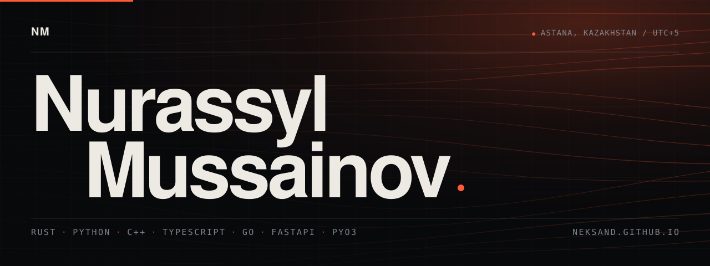
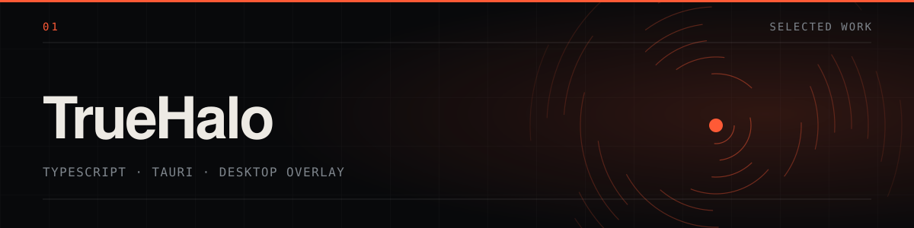
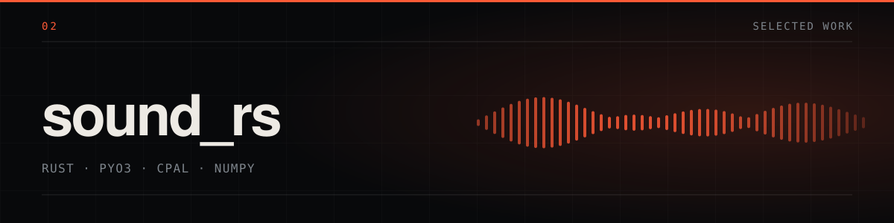

I write backend and systems software, mostly in Rust, Python and C++. I care about
programs that are fast and stay on your machine: local first, minimal dependencies,
no round-trip to someone else's server.

| Field | Value |
|---|---|
| **Location** | Astana, Kazakhstan |
| **Studying** | BSc, Mathematical and Computational Sciences — Astana IT University |
| **Focus** | TrueHalo and sound_rs |
| **Spoken** | Kazakh and Russian (native) · English (C1, IELTS 7.0) |

### 01 — Now

Two projects take almost all of my time.

**TrueHalo** — a native, privacy-first screen overlay for desktop. It reads what is on
your screen and keeps it there: nothing is uploaded, nothing is stored on someone else's
server. Built in TypeScript and Tauri as a lighter alternative to the paid tools people
already use.

[**Repository**](https://github.com/Neksand/TrueHalo)

**sound_rs** — a Python audio library with a Rust core, published on PyPI. It plays files
and raw NumPy arrays with low latency, using CPAL for audio I/O and PyO3 to keep the
Python side thin. In its own benchmark it uses about half the CPU of `sounddevice`.

[**Repository**](https://github.com/Neksand/sound_rs) ·
[**PyPI**](https://pypi.org/project/sound_rs) ·
[**Docs**](https://neksand.github.io/sound_rs/)

### 02 — Background

| Years | What | Where |
|---|---|---|
| 2026&nbsp;—&nbsp;now | BSc, Mathematical and Computational Sciences. Coursework in forecasting and data analytics | Astana IT University |
| Dec 2024 | Kazakh speech recognition and synthesis — dataset work, evaluation, written report and a public presentation | Independent research |
| 2019&nbsp;—&nbsp;2026 | High school diploma, average 4.71 / 5.00 | Gymnasium named after S. Maulenov |

### 03 — Toolkit

| Layer | Tools |
|---|---|
| Languages | `Python` `C++` `Rust` `TypeScript` `Go` |
| Frameworks | `FastAPI` `Flask` `React` `Tauri` |
| Data | `PostgreSQL` `Redis` `NumPy` `Pandas` |
| Ops | `Linux` `Git` `Docker` |
| AI | `Hugging Face Transformers` `Vosk` `OpenAI API` `Streamlit` |

### 04 — Get in touch

**[mussainnur@gmail.com](mailto:mussainnur@gmail.com)**

[GitHub](https://github.com/Neksand) ·
[LinkedIn](https://www.linkedin.com/in/nur-mus-a06834345) ·
[Website](https://neksand.github.io/) ·
[CV (PDF)](https://neksand.github.io/Nurassyl_Mussainov_CV.pdf) ·
[+7 771 281 0710](tel:+77712810710)
